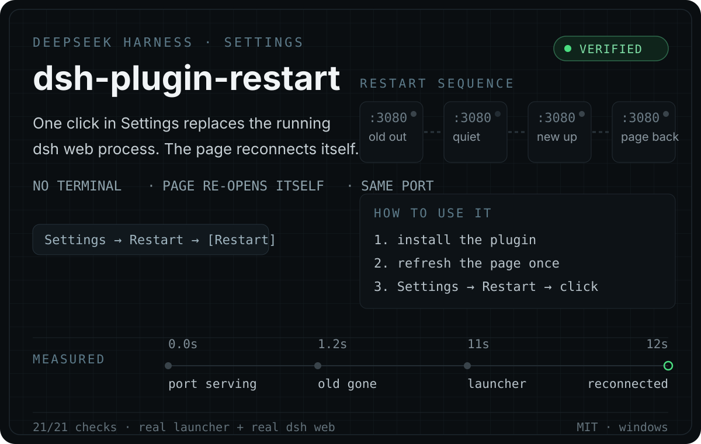

<p align="center">
  
</p>

<p align="center">
  <a href="https://github.com/chenkui-luo/dsh-plugin-restart/blob/main/LICENSE"></a>
  
  
  
</p>

**A Restart card in DeepSeek Harness Settings.** One click replaces the `dsh web` process that is
serving your page — and the page reconnects by itself. No terminal, no re-opening the desktop icon.

That matters because some changes cannot hot-reload:

- you changed a plugin's **host half**, and Node caches imported ES modules by URL;
- you edited `config.json`, the port, or the workspace;
- a session holds in-memory state you want gone.

Today those mean walking back to a terminal. This plugin turns them into one click.

## Try it

```sh
dsh plugin --profile web add github:chenkui-luo/dsh-plugin-restart
```

Then **refresh the page once** and open **Settings → Restart**.

Without the `dsh` CLI (no pnpm, or a patched profile): copy the package into
`<profile>/node_modules/dsh-plugin-restart` and add this row to `<profile>/cordis.patch.yml`:

```yaml
- insert:
    - id: restart
      name: 'dsh-plugin-restart'
```

The bundled installer does both steps with a backup and a read-back check before it writes:

```powershell
powershell -NoProfile -ExecutionPolicy Bypass -File .\scripts\Install-RestartPlugin.ps1
powershell -NoProfile -ExecutionPolicy Bypass -File .\scripts\Install-RestartPlugin.ps1 -Action disable
powershell -NoProfile -ExecutionPolicy Bypass -File .\scripts\Install-RestartPlugin.ps1 -Action uninstall
```

## What happens when you click

| Step | What runs |
| --- | --- |
| 1 | The page sends `POST /dsh-restart/restart` — same origin, authenticated |
| 2 | The host half starts a **detached helper** and answers the request *before* anything is stopped |
| 3 | The helper waits for the port to stop accepting connections, then hands over to your launcher |
| 4 | The launcher starts a fresh `dsh web` with a new launch token and writes its token file |
| 5 | The helper confirms the replacement is up, then lets the old process exit — gracefully |
| 6 | The page sees a new instance id on its next poll and reloads itself |

Nothing is force-killed in the middle of the response, and the old process is stopped **last**, by
itself. A restart that fails leaves a diagnosis in the log instead of failing silently.

## Why the helper is a detached **node** process

This part was measured on a real Windows machine, not assumed:

| how a background helper is started | does it run | does it outlive the process it must replace |
| --- | --- | --- |
| PowerShell, `detached: true` | **no** — exits 0, silently | — |
| PowerShell, attached | yes | no — dies with its parent |
| **node, `detached: true`** | yes | **yes** |
| node, attached | yes | no |

On Windows a "detached" PowerShell child gets no console and never runs the script — the same trap
[dsh-market](https://github.com/dsh-market/dsh-market) documents. An attached helper dies together
with the process it is supposed to replace. So the helper is a detached node process, and it gives
its own children a hidden console through `powershell -WindowStyle Hidden`.

Force-killing the whole tree is the other half of the story: it leaves a Windows port unbindable
long enough for the replacement to die with `EADDRINUSE`. Waiting for the port to go quiet and only
then starting the replacement is what makes the handover reliable.

## Verified, not asserted

| Check | Result |
| --- | --- |
| Helper generation, offline (`runtime-test/CheckHelperScript.mjs`) | 11/11 |
| End to end, real plugin code (`runtime-test/VerifyRestartPlugin.mjs`) | 21/21 |
| **Real** launcher + **real** `dsh web`, full restart cycle (`runtime-test/SmokeRestartReal.ps1`) | pass |

The end-to-end runs cover: the installer writing a managed patch row, the host half claiming its
routes, an unauthenticated request being fenced off, the restart being accepted before the port goes
away, a second click inside the guard window being refused, the port wait, the launcher handover,
the successor process appearing, and the page noticing it.

These live in the toolkit this plugin was built in; this repository is the packaged plugin.

## API

Every route passes the connection trust fence (loopback peer + matching `Origin` + login cookie), so
only an authenticated same-origin page can reach them.

| Method | Path | Meaning |
| --- | --- | --- |
| GET | `/dsh-restart/status` | `instanceId` (this server's pid), port, workspace, launcher path and availability, whether a restart is in flight |
| POST | `/dsh-restart/restart` | Arms a restart. A second request within 15 s gets `409`. The response carries **no** launch token |
| GET | `/dsh-restart/log` | Tail of the shared restart log |

If the automatic reload comes back unauthenticated — a fresh launch token is minted on every start —
the page's own token is handed back to the *same* browser connection once, so it can reopen itself
with `?token=…`.

## Logs

`%LOCALAPPDATA%\DeepSeekHarness\restart-plugin\logs\restart.log` — append-only, so the record of a
restart survives the process that performed it. The helper writes the launcher's exit code, whether
the port is still being served, and whether a fresh token file appeared, because the process that
would normally log a failure is the one that just exited.

## Configuration

| Variable | Purpose |
| --- | --- |
| `DSH_RESTART_INSTALL_DIR` | Launcher runtime directory (default `%LOCALAPPDATA%\DeepSeekHarness`) |
| `DSH_RESTART_DATA` | Plugin-private data directory (default `<INSTALL_DIR>\restart-plugin`) |
| `DSH_RESTART_LAUNCHER` | Point at another launcher script (portable installs, tests) |

**Restart target.** By default it delegates to the launcher a hosted install already has
(`%LOCALAPPDATA%\DeepSeekHarness\Launch-DeepSeekHarness.ps1`), which owns the reliable
stop/start/readiness sequence. When that file is missing the button reports a clear error instead of
pretending to work, and the status card shows the path it looked for. Making the plugin fully
standalone is the next step on the roadmap.

## Safety

- Authenticated same-origin loopback only; proxy-forwarded requests are not honoured.
- No admin rights, no system configuration touched.
- It **interrupts a running conversation turn** — that is what a restart is, and the card says so.
- If the port is owned by a process the launcher does not recognise (a `dsh web` you started by
  hand), the restart takes that port over, including its terminal's process tree.

## Credits

- **DeepSeek Harness (dsh)** — the open-source agent harness this plugin extends and is built on: its
  `dsh.bundle` + `cordis.patch.yml` declaration, the dual host/browser plugin shape, and the
  webserver's trust fence. [deepseek-ai/deepseek-harness](https://github.com/deepseek-ai/deepseek-harness) · MIT.
- **[dsh-market](https://github.com/dsh-market/dsh-market)** — the community plugin market. Its
  `restart.js` is the reference for the approach used here: delegate to a detached helper, wait for
  the port instead of guessing with a fixed delay, and make a failed restart leave evidence.

## License

MIT
