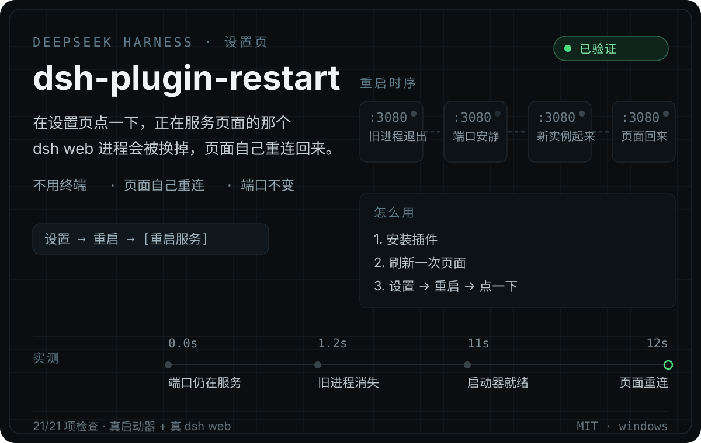

<p align="center">
  
</p>

<p align="center">
  <a href="https://github.com/chenkui-luo/dsh-plugin-restart/blob/main/LICENSE"></a>
  
  
  
</p>

[English](README.md) | 中文

**DeepSeek Harness 设置页里的一个「重启」卡片。** 点一下，正在服务你页面的那个 `dsh web` 进程被换掉，
**页面自己重连回去** —— 不用回终端，也不用重新双击桌面图标。

为什么需要它：有些改动就是没法热加载。

- 改了某个插件的**宿主半**，而 Node 会按 URL 缓存已导入的 ES 模块；
- 改了 `config.json`、端口或工作目录；
- 某个会话的内存状态你想清掉。

以前这三种情况都得回终端敲命令。这个插件把它们变成一次点击。

## 试一下

```sh
dsh plugin --profile web add github:chenkui-luo/dsh-plugin-restart
```

装完**刷新一次页面**，打开 **设置 → 重启**。

没有 `dsh` CLI（比如本机没装 pnpm，或 profile 是手工补的）：把包复制到
`<profile>/node_modules/dsh-plugin-restart`，再往 `<profile>/cordis.patch.yml` 加这一行：

```yaml
- insert:
    - id: restart
      name: 'dsh-plugin-restart'
```

随包的安装脚本会把这两步都做掉，且**写之前先备份、写之后回读校验**：

```powershell
powershell -NoProfile -ExecutionPolicy Bypass -File .\scripts\Install-RestartPlugin.ps1
powershell -NoProfile -ExecutionPolicy Bypass -File .\scripts\Install-RestartPlugin.ps1 -Action disable
powershell -NoProfile -ExecutionPolicy Bypass -File .\scripts\Install-RestartPlugin.ps1 -Action uninstall
```

## 点下去之后发生了什么

| 步骤 | 实际在跑的东西 |
| --- | --- |
| 1 | 页面发出 `POST /dsh-restart/restart` —— 同源、带登录态 |
| 2 | 宿主半启动一个**分离的辅助脚本**，并且**先回答请求**，之后才动手 |
| 3 | 辅助脚本等端口不再接受连接，然后把活交给你的启动器 |
| 4 | 启动器拉起一个全新的 `dsh web`（新的启动令牌），并写出令牌文件 |
| 5 | 辅助脚本核对新实例确实起来了，才让旧进程优雅退出 |
| 6 | 页面在下一次轮询里看到新的实例 id，自己刷新回连 |

响应发到浏览器之前不会强杀任何东西；旧进程是**最后**停的，而且是它自己退出。重启失败也不会静默 ——
辅助脚本会把诊断写进日志。

## 为什么辅助脚本是**分离的 node 进程**

这一段是在真实 Windows 机器上量出来的，不是想出来的：

| 辅助脚本的启动方式 | 能跑 | 活过它要替换的那个进程 |
| --- | --- | --- |
| PowerShell，`detached: true` | **否**（静默退出 0） | — |
| PowerShell，附着 | 是 | 否（随父进程死） |
| **node，`detached: true`** | 是 | **是** |
| node，附着 | 是 | 否 |

Windows 上被要求「分离」的 PowerShell 子进程拿不到控制台，脚本根本不会执行 —— 这正是
[dsh-market](https://github.com/dsh-market/dsh-market) 注释里记的那个坑。而附着的辅助脚本会跟着它要替换的
进程一起死。所以辅助脚本是**分离的 node 进程**，它自己再用 `powershell -WindowStyle Hidden`
给下面的子进程一个隐藏控制台。

另一半经验是：**强杀整棵进程树**会让 Windows 的端口迟迟不能重绑，替换实例就会以 `EADDRINUSE`
秒死。等端口真的安静下来、再启动替换实例，才是让交接可靠的关键。

## 验证过，而不是声称

| 检查 | 结果 |
| --- | --- |
| 辅助脚本离线检查（`runtime-test/CheckHelperScript.mjs`） | 11/11 |
| 端到端、真实插件代码（`runtime-test/VerifyRestartPlugin.mjs`） | 21/21 |
| **真启动器 + 真 `dsh web`**，完整重启一轮（`runtime-test/SmokeRestartReal.ps1`） | 通过 |

端到端覆盖的点：安装脚本写入托管块、宿主半占住路由、未登录请求被围栏拦掉、重启请求先于端口消失被接受、
15 秒内重复点击被拒、等端口、交接给启动器、新进程出现、页面发现它。

这些自检在构建这个插件的工具包里；本仓库是打包后的插件本体。

## 接口

所有路由都先过连接信任围栏（本机地址 + 同源 `Origin` + 登录 Cookie），只有已登录的同源页面能访问。

| 方法 | 路径 | 含义 |
| --- | --- | --- |
| GET | `/dsh-restart/status` | `instanceId`（本进程 pid）、端口、工作目录、启动器路径与是否存在、是否有重启在进行 |
| POST | `/dsh-restart/restart` | 安排重启；15 秒内第二次请求返回 `409`；响应**不含**启动令牌 |
| GET | `/dsh-restart/log` | 共享重启日志的尾部 |

万一自动刷新后认不出登录态（每次启动都会换新令牌），插件会把**这个页面自己带的令牌**还给**同一条**
浏览器连接（只还一次），页面因此能用 `?token=…` 自己重开。

## 日志

`%LOCALAPPDATA%\DeepSeekHarness\restart-plugin\logs\restart.log` —— **只追加不截断**，所以一次重启的记录
能活过执行它的那个进程。辅助脚本会写下启动器退出码、端口是否还有人服务、有没有出现新的令牌文件；
因为本该记录失败的那个进程，正好就是刚刚退出的那个。

## 配置

| 变量 | 作用 |
| --- | --- |
| `DSH_RESTART_INSTALL_DIR` | 启动器运行目录（默认 `%LOCALAPPDATA%\DeepSeekHarness`） |
| `DSH_RESTART_DATA` | 插件私有数据目录（默认 `<INSTALL_DIR>\restart-plugin`） |
| `DSH_RESTART_LAUNCHER` | 指定别的启动器脚本（便携安装、自检用） |

**重启委托给谁。** 默认交给托管安装本来就有的启动器
（`%LOCALAPPDATA%\DeepSeekHarness\Launch-DeepSeekHarness.ps1`），停止/启动/等待就绪这套可靠流程由它负责。
这个文件缺失时，按钮会明确报错而不是假装成功，状态卡片里也会显示它去找的路径。让它完全不依赖启动器是
下一步计划。

## 安全性

- 只对本机 + 同源 + 已登录开放；不接受任何转发头语义。
- 不需要管理员权限，不改系统配置。
- 会**中断当前正在跑的对话回合** —— 这是重启的本来含义，卡片上也写了。
- 若端口被启动器不认识的进程占着（比如你手动开的 `dsh web`），重启会接管该端口，连同它的终端进程树。

## 致谢

- **DeepSeek Harness (dsh)** —— 本插件扩展并建立其上的开源 agent harness：`dsh.bundle` +
  `cordis.patch.yml` 的声明方式、宿主半/浏览器半的双半形态、以及 webserver 的信任围栏。
  [deepseek-ai/deepseek-harness](https://github.com/deepseek-ai/deepseek-harness) · MIT。
- **[dsh-market](https://github.com/dsh-market/dsh-market)** —— 社区插件市场。它的 `restart.js` 是本文
  做法的参考来源：交给分离的辅助进程、等端口而不是拍一个固定延时、以及让失败的重启留下证据。

## 许可

MIT
